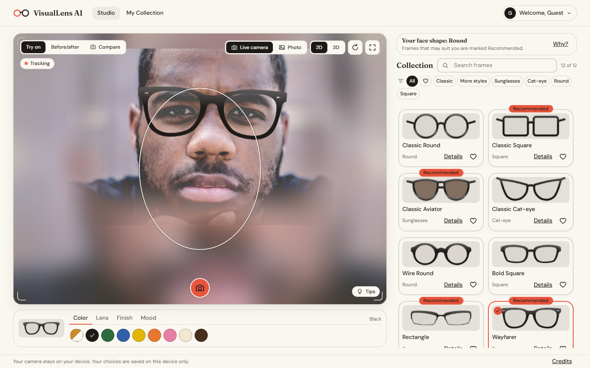
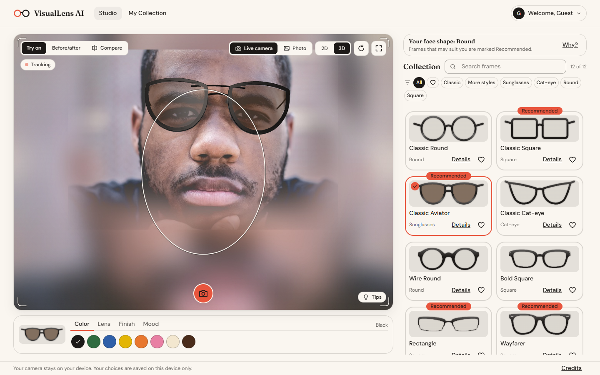
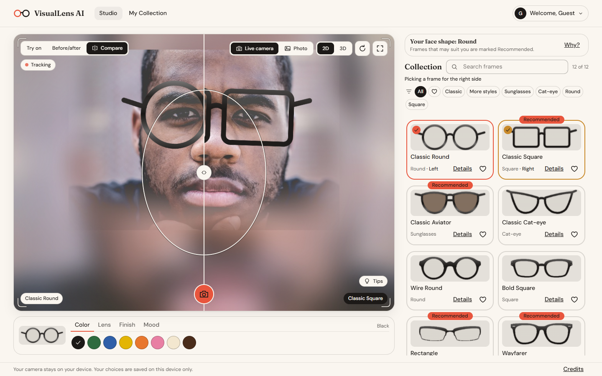
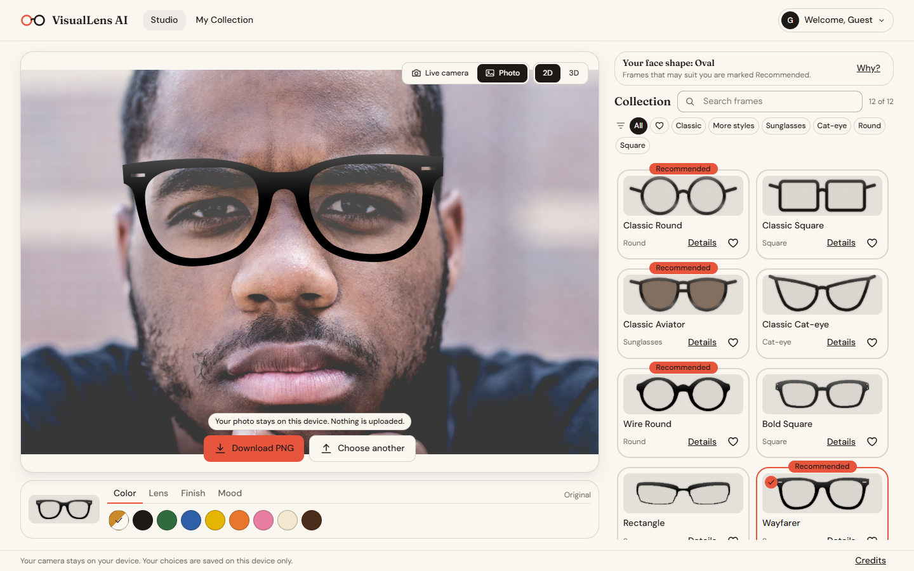
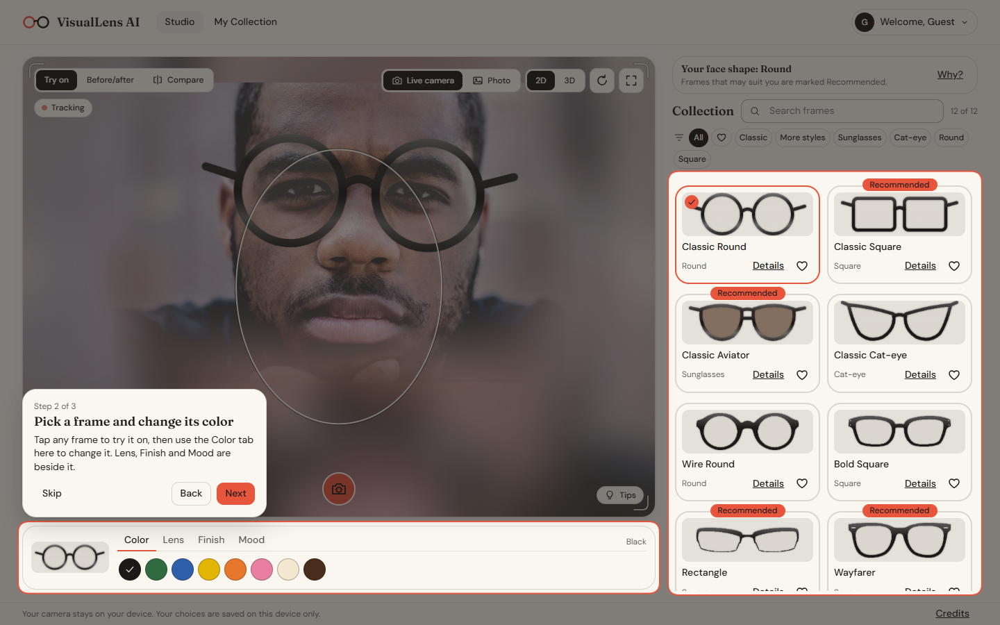
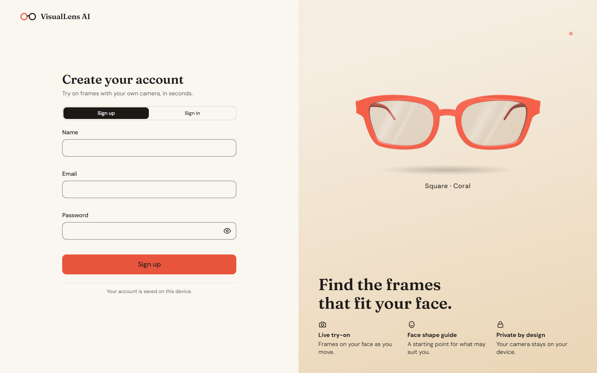
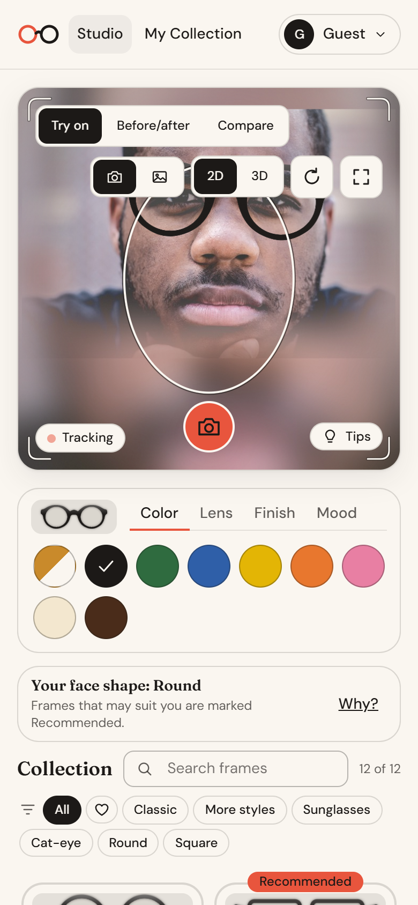

# Ainak Studio

**Try on glasses in your browser, live on camera or on a photo.**

Ainak Studio (shown in the app as *VisualLens AI*) is a virtual eyewear try-on. It finds your face with on-device face tracking, places frames on it in 2D or 3D, and lets you change colors, lenses and finishes as you go. It also suggests frames for your face shape. Everything runs in your browser: video and photos never leave your device.



## Contents

- [Features](#features)
- [Screenshots](#screenshots)
- [Privacy](#privacy)
- [Getting started](#getting-started)
- [How it works](#how-it-works)
- [Project structure](#project-structure)
- [Known limitations](#known-limitations)
- [Credits](#credits)

## Features

**Try-on**
- **Live camera:** glasses follow your face as you move, with smoothing so they don't jitter.
- **Photo mode:** upload a JPG or PNG (up to 10 MB) by button or drag and drop, and download the result as a PNG.
- **2D and 3D:** flat frame art, or real 3D frames with reflections and a head model that hides the arms behind your ears.
- **12 frames** in two groups, Classic and More styles, with search and filters by style.

**Customize**
- **Color, Lens, Finish and Mood** tabs under the video, with a live preview of the frame.
- **Lenses:** clear, light tint, sunglass tint or gradient, in several tints.
- **Finishes:** glossy, matte or metallic.
- **Moods:** Studio, Golden Hour and Film Noir change how the video looks, never the glasses.

**Compare and keep**
- **Before/after** and **Compare** views, with a divider you can drag.
- **Capture** a photo with a countdown, then download it or save it to *My Collection*.
- **Favorites**, remembered on your device.

**Guidance**
- **Face shape suggestions:** estimates your face shape and marks frames that may suit it as *Recommended*. *Why?* explains the reasoning. It's a style guide, not a measurement.
- **Live hints** such as *Center your face*, *Move closer* or *More light please*, plus a tracking status.
- **A short first-visit tour** that points out the main controls, and can be replayed from the user menu.
- **Tips for best results**, one tap away on the video.

**Built to keep working**
- Friendly messages, with a way forward, when the camera is blocked, missing, busy or unplugged.
- The face model is cached after the first visit, and a slow or failed download offers *Try again*.
- If saving on the device fails or saved data is damaged, the app carries on with defaults and says so.
- A *Reload* screen instead of a blank page if something breaks.

## Screenshots

| 3D frames | Compare two frames |
|---|---|
|  |  |

| Photo mode | First-visit tour |
|---|---|
|  |  |

| Sign in | On a phone |
|---|---|
|  |  |

## Privacy

- **Your camera stays on your device.** Face tracking runs in the browser. No video or photo is sent anywhere.
- **The only downloads** are the app itself, the fonts (from Google Fonts), the face model and the MediaPipe runtime. The model is then cached, so later visits don't download it again.
- **Your choices are saved on this device** (in the browser's localStorage): your frame, color, lens, finish, mood, favorites and saved photos.

## Getting started

You need [Node.js](https://nodejs.org/) 20.19 or newer.

```bash
git clone https://github.com/Iqranawaz-debug/Ainak-Studio.git
cd Ainak-Studio
npm install
npm run dev
```

Then open the address Vite prints, usually http://localhost:5173, create an account, and allow the camera.

| Command | What it does |
|---|---|
| `npm run dev` | Starts the development server |
| `npm run build` | Builds the production version into `dist/` |
| `npm run preview` | Serves the built version locally |

Browsers only allow the camera on `localhost` or over HTTPS, so host the built app on HTTPS. Without a camera you can still use Photo mode.

## How it works

1. **Face tracking.** [MediaPipe Face Landmarker](https://ai.google.dev/edge/mediapipe/solutions/vision/face_landmarker) finds 478 points on your face in each video frame, along with the head's position and rotation. With several faces in view, it uses the largest.
2. **Fit.** The frames are centered between the irises. Their width comes from the distance between the outer eye corners, and their tilt from the line joining those corners.
3. **Drawing.** In 2D the frame art is drawn on a canvas over the video. In 3D, [three.js](https://threejs.org/) renders real frame models, using the head pose for rotation and an invisible head model so the arms disappear behind your head.
4. **Face shape.** A few ratios between landmarks (face length, jaw and forehead width compared with the cheekbones) are averaged over about two seconds of steady, front-facing video, then matched to a face shape.

## Project structure

```
src/
  pages/            Sign-in, Studio and My Collection pages
  components/       The interface, including FaceCamera (live try-on) and PhotoStudio
  components/ui/    Shared building blocks: buttons, cards, chips, modals, tooltips
  frames/           The frame catalog, colors, lenses and finishes, and saved choices
  glasses3d/        3D frame models and the 3D scene
  faceDetection.js  Loads the face model and picks the largest face
  glassesOverlay.js 2D fit and drawing
  faceShape.js      Face shape estimate and recommendations
  faceGuide.js      Line-up hints and tracking status
  storage.js        Safe saving on the device
public/frames/      Frame art, with its licenses in licenses.md
docs/screenshots/   The images in this README
```

Built with React, Vite, Tailwind CSS, three.js and MediaPipe.

## Known limitations

- **Accounts are not secure.** Sign-in is a placeholder that keeps accounts in the browser. Replace it with a real backend before using this in production.
- **Saved data stays in one browser.** Nothing syncs between devices, and clearing site data removes it.
- **Face shape is approximate.** The thresholds were tuned on a few test portraits, not a wide range of faces, and a single photo gives a less steady estimate than live video.
- **Speed depends on the device.** Face tracking is the heaviest part, and older phones may run at a lower frame rate.

## Credits

- **Frame art:** from [Openclipart](https://openclipart.org/), released under CC0 1.0. Each file, its author and its changes are listed in [public/frames/licenses.md](public/frames/licenses.md).
- **Screenshot portrait:** [Face portrait](https://commons.wikimedia.org/wiki/File:Face_portrait_(Unsplash).jpg) by William Stitt, released under CC0 1.0. Details are in [public/frames/licenses.md](public/frames/licenses.md).
- **Face tracking:** [MediaPipe](https://github.com/google-ai-edge/mediapipe) by Google, under the Apache License 2.0.
- **3D rendering:** [three.js](https://github.com/mrdoob/three.js), under the MIT License.
- **Fonts:** [Fraunces](https://fonts.google.com/specimen/Fraunces) and [DM Sans](https://fonts.google.com/specimen/DM+Sans), under the SIL Open Font License.

## License

The code is released under the [MIT License](LICENSE). The frame art, fonts and libraries listed under [Credits](#credits) keep their own licenses.
